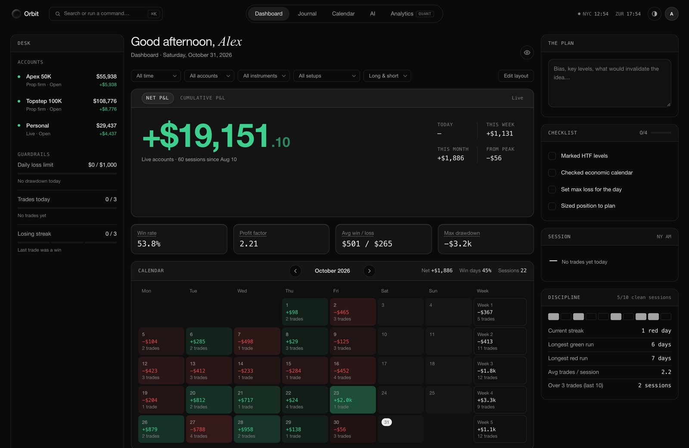

# Orbit

A trading journal for the Mac. Import your trades from a CSV or sync them from Tradovate, review them day by day, and get the stats that actually matter: equity curve, win rate, R-multiples, drawdown, expectancy and an edge test. Everything stays on your machine.

  
  

*Screenshots use sample data.*

## Features

- Dashboard with accounts, daily loss and trade guardrails, a pre-session checklist and a P&L calendar
- Journal and calendar views to review each day's trades, with setups, grades and notes
- Quant analytics: Sharpe, Sortino, SQN, Kelly, expectancy, drawdown, and a significance test on your edge
- Tradovate sync (experimental) and CSV import
- Optional AI coach that uses your own Anthropic key
- No account and no server. Broker credentials and keys are stored encrypted in the macOS Keychain.

## Status

Closed beta for Apple Silicon Macs. There's no public download yet.

Orbit is a journaling and analysis tool, not financial advice.

## License

Proprietary, all rights reserved. Source isn't published. See [LICENSE.txt](LICENSE.txt).
