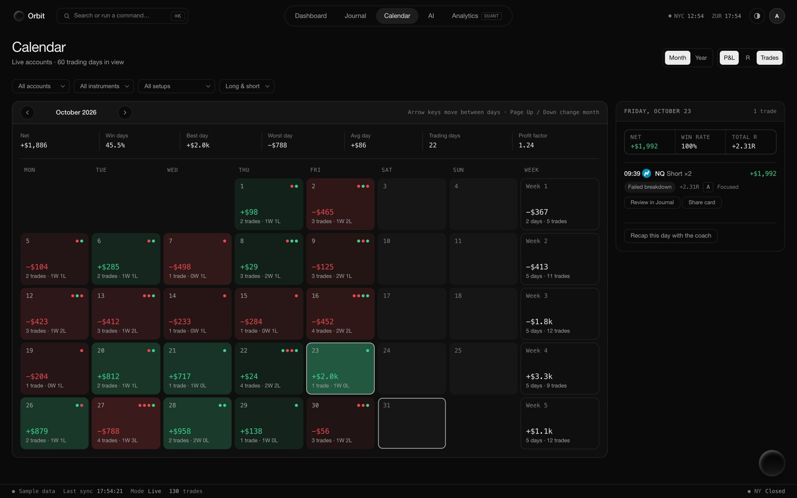
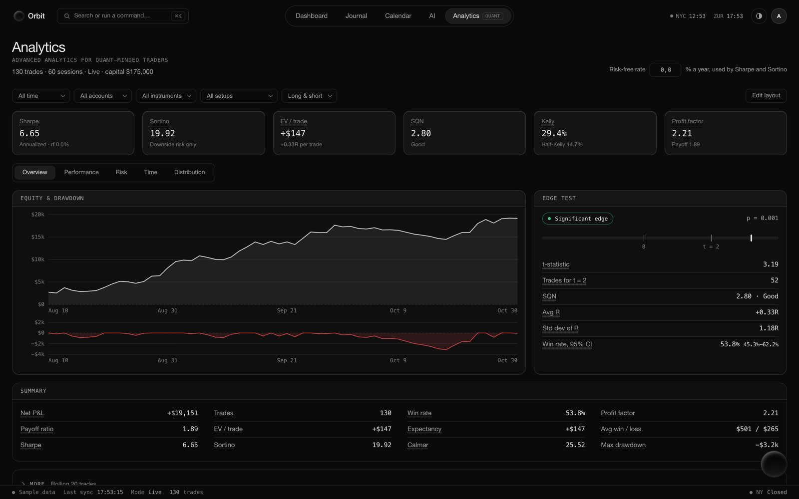

# Orbit

A trading journal for the Mac. Import your trades from a CSV or sync them from Tradovate, review them day by day, and get the stats that actually matter: equity curve, win rate, R-multiples, drawdown, expectancy and an edge test. Everything stays on your machine.

  
  

*Screenshots use sample data.*

**[Download for macOS (Apple Silicon)](https://github.com/unpaidfunds/orbit/releases/latest/download/Orbit-0.1.0-arm64.dmg)** · [All releases](https://github.com/unpaidfunds/orbit/releases)

## Features

- Dashboard with accounts, daily loss and trade guardrails, a pre-session checklist and a P&L calendar
- Journal and calendar views to review each day's trades, with setups, grades and notes
- Quant analytics: Sharpe, Sortino, SQN, Kelly, expectancy, drawdown, and a significance test on your edge
- CSV import into the account you choose (right-click an account to upload), with per-contract commissions so P&L is net; click an account to see only its data
- Tradovate sync (experimental)
- Optional AI coach that uses your own Anthropic key
- No account and no server. Broker credentials and keys are stored encrypted in the macOS Keychain.

## Install

1. Download the `.dmg` from Releases and drag **Orbit** into Applications.
2. The app isn't signed by Apple yet: **right-click Orbit › Open › Open** the first time. If macOS still blocks it, go to System Settings › Privacy & Security › **Open Anyway**.

Requires an Apple Silicon Mac. Your data stays on your device.

## Status

Free closed beta. Expect rough edges. Source is not public; see [LICENSE.txt](LICENSE.txt).

Orbit is a journaling and analysis tool, not financial advice.
